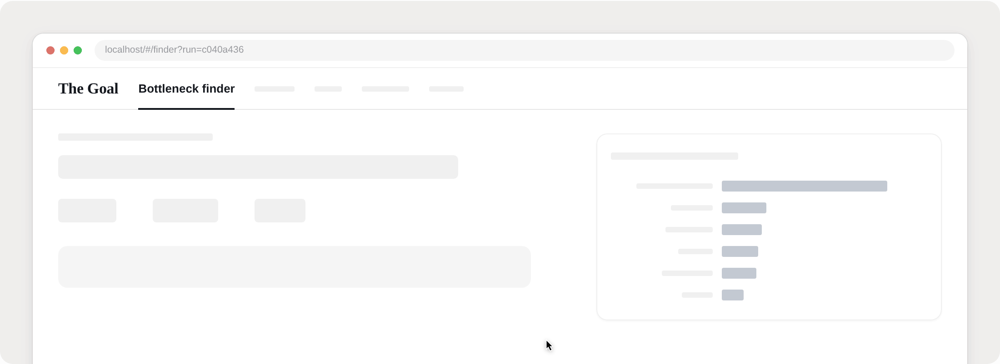
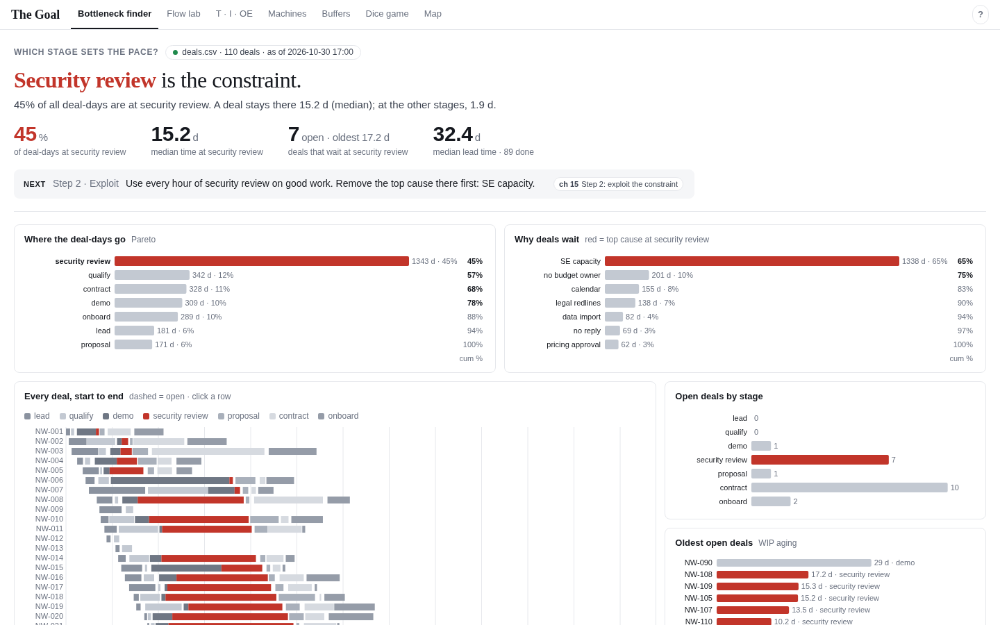
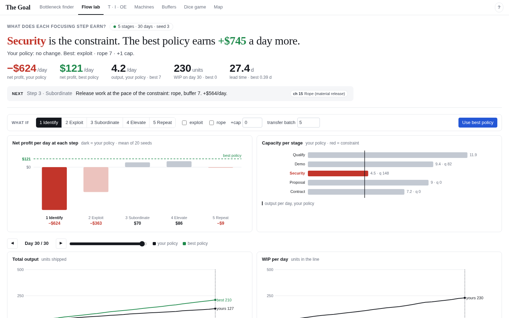
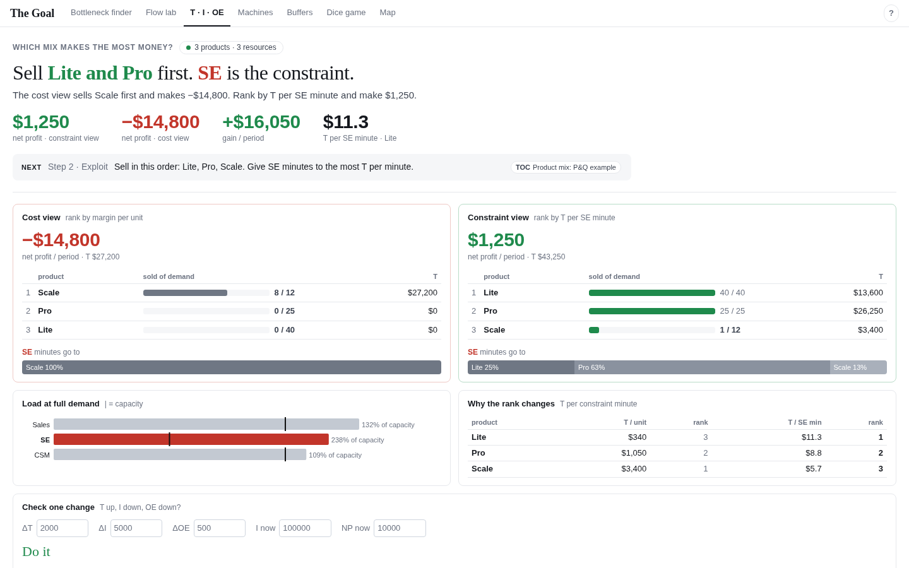
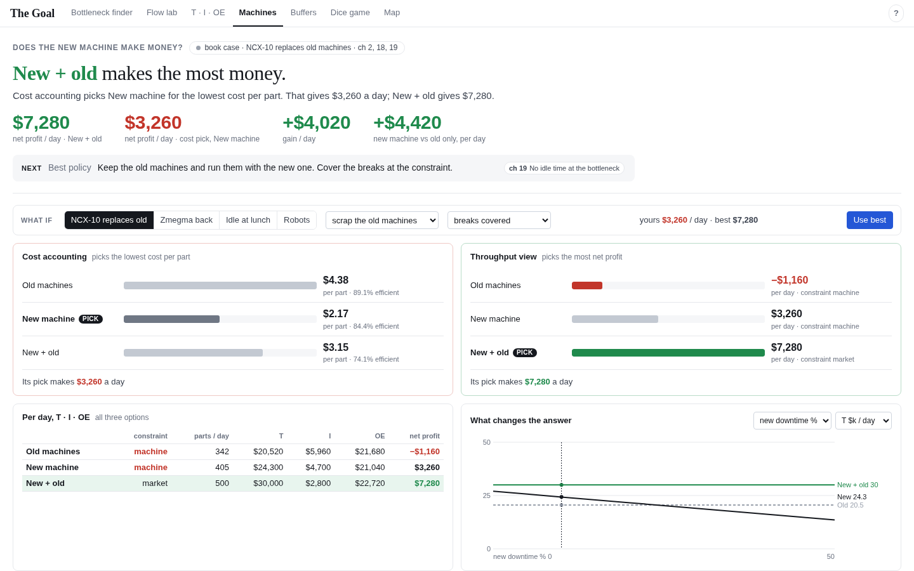
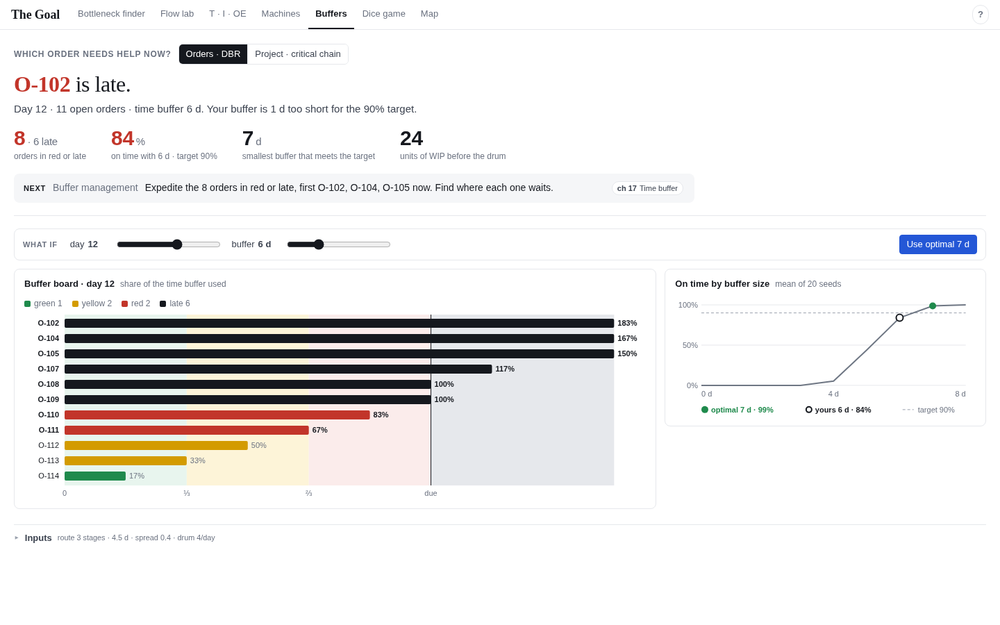
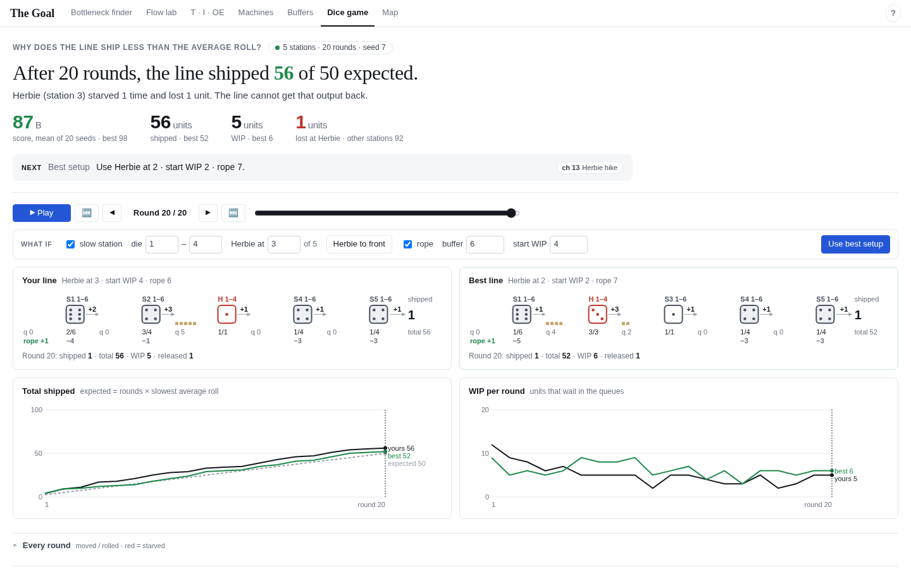
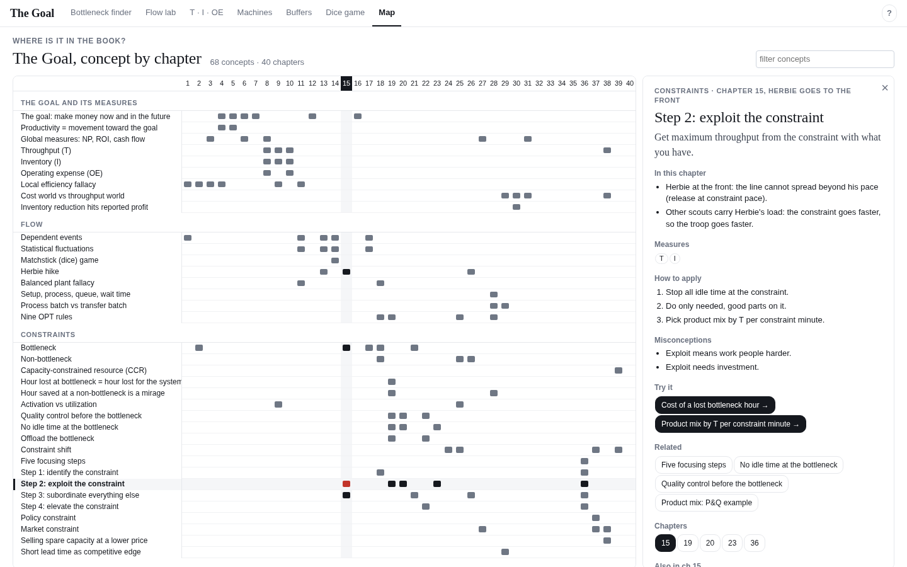

# The Goal toolkit

Theory of Constraints concepts, tools and visual reports from *The Goal* by Eliyahu M. Goldratt.



Open `app/index.html` in a browser, or run `bin/goal serve`. The CLI needs Python 3 only. Screenshots (`--shot`, `bin/goal shot`) need [playwright-cli](https://github.com/microsoft/playwright-cli).

Agent first: the agent runs `bin/goal` on your data and sends a link and a screenshot. You open the link to see the proof and to test changes.

Each view: the question, the verdict, the numbers, the next step and its chapter in the book. Then the proof. Red is the constraint, and only the constraint.

Demo data: [examples/demo-crm](examples/demo-crm/README.md), the sales pipeline of a fictional company.



| | |
|---|---|
|  |  |
| Flow lab: what each focusing step earns per day | T · I · OE: cost view vs constraint view |
|  |  |
| Machines: does the new machine make money? | Buffers: which order needs help now? |
|  |  |
| Dice game: dependent events and fluctuations | Map: each concept by chapter |

## CLI

```sh
bin/goal analyze examples/orders.csv     # constraint, Pareto, WIP aging
bin/goal flow --stages examples/stages.json
bin/goal sim dice --seed 7 --slow 3 --rope
bin/goal mix examples/pq.json
bin/goal tree new crt > crt.json && bin/goal tree validate crt.json
bin/goal open finder
```

Add `--show` to `analyze`, `flow`, `mix`, `machines` or `sim dice` to get the app URL of that exact result. `--shot out.png` also saves a screenshot. `bin/goal shot TAB --out x.png` screenshots any view.

```sh
bin/goal --shot finder.png analyze examples/demo-crm/inputs/deals.csv --unit deal
```

JSON output when piped or with `--json`. Agent skill: [skills/the-goal/SKILL.md](skills/the-goal/SKILL.md). Agent notes: [AGENTS.md](AGENTS.md).

## Private cases

Put your own data in `local/cases/NAME/` (gitignored). Start from [examples/case-template](examples/case-template).
`bin/goal case build NAME` writes `local/cases.js`; the app adds tab `#/case/NAME`. No `local/` = no case tabs.

## CSV format (Bottleneck finder)

`id,stage,start,end,cause,owner`. ISO dates or `YYYY-MM-DDTHH:MM` (UTC). Empty `end` = open item. `cause` and `owner` are optional. [examples/orders.csv](examples/orders.csv) is synthetic.

License: MIT.
